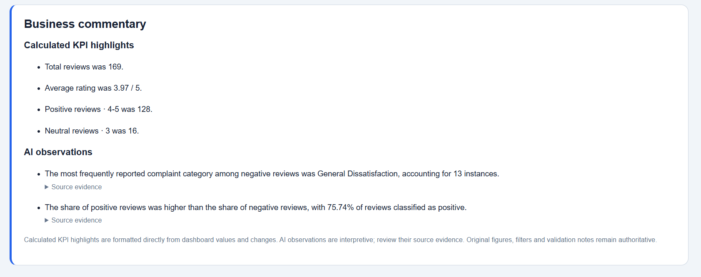
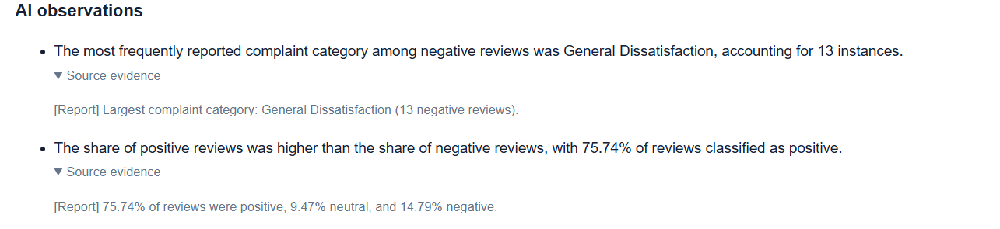
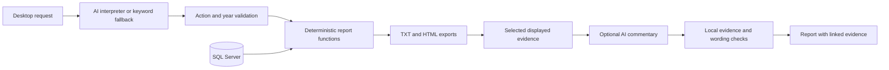

# Venesse Business Agent

**SQL Server business reporting with a Python desktop interface and evidence-linked AI commentary.**

Venesse turns a business request into a validated report covering sales, customer purchasing, retention, products, marketing, feedback, or operating profitability. A desktop window provides eight dashboard shortcuts and custom request entry. Reports combine deterministic calculations with separately labeled AI observations.

This Python component extends the repository’s SQL, DAX, and Power BI analytics with automated reporting and a desktop request interface.

## Business problem

Reviewing performance across several business areas requires consistent reporting periods, financial definitions, and supporting evidence. This project brings those analyses into one workflow: retrieve data, validate it, calculate metrics, export a report, and optionally summarize selected evidence with an LLM.

## Features

- Seven HTML dashboards and one combined business report.
- TXT reports and supported year comparisons.
- Revenue, historical COGS, gross profit, margin, and monthly reconciliation.
- Customer purchase frequency, previous-year cohort retention, and historical revenue at risk.
- Product profitability, campaign performance, feedback, and provisional operating results.
- Natural-language interpretation constrained to implemented actions and validated years.
- AI commentary with expandable source evidence and local checks.
- Compact evidence selection, session commentary caching, and token usage metadata.
- Desktop interface built with Tkinter; HTML reports support browser printing.

## Screenshots

### Feedback report: highlights and AI observations


### Expandable source evidence


These screenshots show a report generated during development. Commentary can vary with the model response. The screenshot captions do not imply independent verification of the source database.

## Architecture



Model output does not execute arbitrary SQL or Python. Report functions use parameterized SQL queries. Calculated values remain separate from generated observations.

## Technology

Python, Pandas, pyodbc, SQL Server, Tkinter, HTML/CSS/SVG, and an OpenAI-compatible SDK configured for NanoGPT. The tested model configuration is `qwen3-30b-a3b-instruct-2507`. Dependencies are pinned to the versions used in the development environment.

## Setup

This repository contains the application source. **The SQL database, schema migration scripts, and source dataset are not included.** A compatible existing Venesse database is required to generate live dashboards. You can run the offline regression tests without it.

1. Use Windows with Python including Tkinter and Microsoft ODBC Driver 17 for SQL Server.
2. Create a virtual environment and install dependencies:

   ```powershell
   python -m venv .venv
   .\.venv\Scripts\python.exe -m pip install -r requirements.txt
   ```
3. Configure `VENESSE_DB_SERVER` for your SQL Server instance. Database name defaults to `Venesse`; Windows authentication is used. Optional settings: `VENESSE_DB_DATABASE` and `VENESSE_DB_DRIVER`.
4. For AI features, configure `VENESSE_AI_PROVIDER=nanogpt`, `VENESSE_AI_MODEL=qwen3-30b-a3b-instruct-2507`, and your private `NANOGPT_API_KEY` in your local environment or PyCharm run configuration. Do not place keys in source files. `.env` files are ignored by Git, but this application does not automatically load them.
5. Launch:

   ```powershell
   .\.venv\Scripts\python.exe venesse_desktop.py
   ```

Without AI credentials, keyword routing and deterministic reports remain available. AI observations are skipped. Live SQL access is still required for report generation. Groq and SiliconFlow are supported by the shared client but require their own SDK/configuration; this package's requirements target NanoGPT.

## Example requests

```text
Generate full HTML report for 2026
Generate sales HTML report for 2026
Generate feedback HTML report for 2023
Compare customer purchasing between 2025 and 2026
Export customer comparison for 2025 and 2026
```

Select a year and click a dashboard shortcut, or type a request. Reports and usage metadata are saved in `reports/`. HTML exports can open in the browser and can be reopened with Open last report. Current Chrome/Edge is required for the combined report's declarative shadow DOM.

## Example development results

For January–September 2026, the working database produced these delivered-sales results:

| Metric | Value |
|---|---:|
| Revenue | $938,352.11 |
| Historical COGS | $709,254.71 |
| Gross profit | $229,097.40 |
| Gross margin | 24.41% |

These are development reference figures, not claims about an independently audited business or a public benchmark. The database needed to reproduce them is not distributed here.

## Validation

```powershell
.\.venv\Scripts\python.exe test_venesse_regression.py
```

The package passed **22 offline regression tests** in the existing development environment. The suite blocks SQL/network connections, uses sample data, and checks sales calculations, invalid values/dates, command validation, dispatch, TXT/HTML exports, AI failure paths, cache invalidation, highlights, feedback evidence, and usage tracking. It does not validate every business calculation or replace live integration testing. A fresh dependency installation has not been tested.

## AI usage and cache

Request totals show input/output tokens, API attempts, cache hits, and attempts with unavailable usage. `reports/ai_usage.jsonl` stores metadata without prompts or keys. Commentary reuse lasts only for the current process and checks displayed evidence and AI settings. Changed figures invalidate reuse; export timestamps alone do not. SQL reports still regenerate, and request interpretation can still use tokens.

Cost is blank unless model-specific rates are supplied. See [usage details](docs/USAGE.md). Estimates are not provider bills or a spending cap.

## Reporting limitations

- All reports cover January–September. Delivered sales use status 6; feedback uses order dates without that status filter.
- Repeat purchasing within a period and cross-year cohort retention are different measures.
- Historical revenue at risk is not forecast lost revenue.
- Operating results remain provisional because campaign-cost overlap with expenses is unresolved.
- Missing baseline data is not zero. Commentary omits unavailable prior-year comparisons; original dashboard cells can still show N/A.
- AI reviews a selected evidence sample. Numeric and wording checks cannot establish every narrative claim. Standalone table rows are rejected as narrative evidence; source statements still require human review.
- Combined reports can mark sections unavailable. Fetch reuse within an export is not a database transaction snapshot.

## Repository guide

- `venesse_desktop.py`: desktop entry point.
- `venesse_ai_agent_edit.py`: SQL retrieval, calculations, validation, routing, TXT exports, and HTML adapters.
- `venesse_*_html.py` / `venesse_html.py`: dashboard exporters.
- `venesse_ai_client.py`: provider connection and usage tracking.
- `venesse_ai_interpreter.py`: request interpretation.
- `venesse_ai_summary.py`: evidence selection, commentary, cache, and report enrichment.
- `test_venesse_regression.py`: offline checks.

See [database requirements](docs/DATABASE.md).
